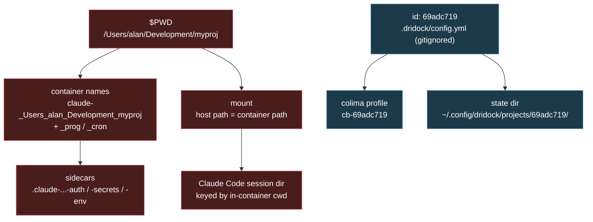

# Path independence — a project's identity is declared, not inferred

**Status:** specified, not yet implemented — **#123, slated for 6.0.0, Bear builds it** (Alan, 2026-11-15). The inventory and the measurements below are current. The two decisions this design left to Alan are now made and marked in place: `name:` lives in the tracked `project.yml`, and the scheme change ships in 6.0.0. **Land [#124](https://github.com/aberezin/docker-claudebox/issues/124) first** — adopt-by-recreate walks straight into its feature-marker gap.

A git repository does not care what its directory is called. You can `mv` a clone anywhere and every commit, branch and remote comes with it, because git's identity lives *inside* the directory. dridock is half of the way there: the VM and the per-project state are keyed on a declared `id:`, but the container, its sidecars and the claudebot's session history are keyed on the absolute path. So a rename silently starts the project over (#121).

This document says what identity should be keyed on, what the one irreducible path dependency is and why, and how a naming change adopts existing containers instead of stranding them.

## What identity is today



The blue half is already path-independent and is the model to copy. `Docker.ts:285` is the whole of it:

```ts
export function projectProfile(id: string): string { return `cb-${id}`; }
```

The red half, with its evidence:

| What | Where | What a rename does to it |
|---|---|---|
| Container names, ×3 roles | `ContainerName.ts:14` — `claude-${cwd.replaceAll("/", "_")}` | A *new* container is created. The old one keeps running in the VM under the old name, and `dridock stop` / `down` from the new path cannot see it. |
| Sidecars, including `-secrets` | `SidecarWriter.ts:60` — `${dataDir}/.${baseContainerName}${role}-${kind}` | A fresh set is written; the old set is orphaned. `-secrets` holds real credential values (chmod 600), so this is the one with a security consequence. |
| `DRIDOCK_WORKSPACE` | `StartCommand.ts:348` | Re-derived every run. Harmless. |
| The workspace mount | `StartCommand.ts:455` — `{ host: ctx.cwd, container: ctx.cwd }` | Deliberate, and the one dependency that stays — see [The mount is the exception](#the-mount-is-the-exception). |
| Claude Code's own session dir | Its own state, keyed by its in-container cwd, which is the row above | `--continue` (the interactive and programmatic default) finds nothing. Prior transcripts live on under the old slug. |

`OrphanSessionScanner` already treats "state orphaned because a key changed" as a first-class problem — but only for the `id:` key (#42, a regenerated id). A path rename is the same class and is not covered.

## The target: `claude-<name>-<id>`

Two declared fields, each in the file the [config split](project-config-split.md) assigns it:

- **`name:` in `.dridock/project.yml`** (tracked). A project's name is a property of the project and is identical in every clone, which is exactly the #97 test for belonging in the tracked file. It is a human label — sanitized to `[a-z0-9-]` for use in a container name, never parsed for meaning.
- **`id:` in `.dridock/config.yml`** (gitignored, machine-local). Already exists, already guarantees per-clone uniqueness, already keys the VM. Two clones of the same repo on one host share a `name:` and differ by `id:`.

Container names become `claude-<name>-<id>`, `claude-<name>-<id>_prog`, `claude-<name>-<id>_cron`; sidecars follow the container name as they do now. **All three roles need adopting**, because all three are persistent containers reused via `docker start` rather than recreated per run (`StartCommand.ts:398`, `:415`) — the mount-source sweep at `:269` already walks the same three names.

`name:` goes in the **tracked** `project.yml` (Alan's call, 2026-11-15): it is a property of the project, identical in every clone, which is the #97 test.

### A new project must declare its name

**A name is required wherever a project's identity is created** (Alan, 2026-11-15). `dridock bootstrap` is the only such path — `dridock start` refuses outside an existing project (`StartCommand.ts:95`) — and it takes `--name <label>`. With no name available it exits non-zero and prints the name it *would* have inferred, so supplying it is one copy-paste:

```
dridock bootstrap: --name is required (a project's name is part of its identity)
   suggested from this directory:  --name my-proj
```

A flag rather than a prompt, so a non-interactive or scripted bootstrap behaves the same as an interactive one. No value is secret, so this does not touch the secrets-are-file-based rule — that rule is about credential *values*, and a project label is neither.

**"Creates an identity" is narrower than "runs bootstrap", and the difference matters** (`BootstrapCommand.ts:14-24`):

| Mode | Needs `--name`? |
|---|---|
| plain `bootstrap` (new project) | **yes** — nothing declares a name yet |
| `--adopt [<url>]` of a repo whose tracked `project.yml` already has `name:` | **no** — it already has one; see precedence below |
| `--adopt` of a repo with no `name:` | **yes** |
| `--brief-only` | **no** — rewrites BRIEF.md, creates no identity |
| `--workspace` / `--multi-repo` with `--repo <url>` | **yes, for the parent only** — the cloned siblings are not dridock projects |
| `--secrets-file`, `--seed-secret`, `--force`, `--no-start`, `--brief-file` | unchanged — orthogonal |

**Precedence, because `name:` is tracked and therefore travels with a clone:** a tracked `name:` wins and is never rewritten. `--name` is required only when none is present, and a `--name` that **disagrees** with a tracked `name:` is a hard error naming both values — not a silent overwrite of a file in the user's git tree, and not a silent ignore of what they typed. Without this rule, requiring a name would fail the bootstrap of every second clone of a dridock project, demanding a name the repo already carries (Bear, #123 review).

**Sanitization, defined once and applied everywhere** (`--name`, and the adoption inference below): lowercase, keep `[a-z0-9-]`, collapse runs of `-`, trim leading and trailing `-`. If the sanitized form differs from what was supplied, the command prints both and uses the sanitized one — `--name "My Proj"` becomes `my-proj` visibly, never silently. If sanitization leaves nothing, creation refuses.

**Two clones of one project share a `name:` and differ by `id:`.** That is the design working, not a collision: `docker ps` shows `claude-myproj-69adc719` beside `claude-myproj-3f2ab891`, which is also how the colima profiles already look (`cb-<id>`).

Why require it rather than default it: a name inferred from the directory is a name nobody chose, and it is inferred from the very thing this design is making disposable. Two sibling checkouts (`myproj`, `myproj-2`) would silently become two differently-named projects; rename the directory before the first start and the name silently changes with it. Declaring it once at creation is also what makes it stable afterwards — a later rename never touches it.

**The one path that may infer is adoption of a project that predates this**, which is every project that exists today. There, adoption writes `name:` **once**, as the sanitized basename, into `project.yml` (created lazily, per the #97 rule that nothing lands in a git tree unasked), with a stderr line saying it did and what it wrote. Note the asymmetry with `--adopt` above: a *clone* of an already-migrated project needs no name because the tracked file carries one, while a project being migrated for the first time has no such file to read. That is an inference the user can see and edit, not a silent default — and it only ever happens on the upgrade, never for a new project.

If sanitization leaves nothing (a basename with no `[a-z0-9]` at all) the adoption path omits the name and the container is plain `claude-<id>`: still path-independent, still unique. A label nobody can read is not worth a failed start on an upgrade — but on *creation* the same case is a refusal, because there a human is right there to pick a better one. `docker ps` becomes *more* legible than today's `claude-_Users_aberezin_Development_ai-claude-code_...`, not less.

With that, a rename changes nothing the harness owns. No new container, no orphaned sidecars, no credential files left under a dead name.

## The mount is the exception

The workspace is mounted at **its own host path** inside the container, and that is load-bearing rather than incidental: a claudebot runs `docker` against the host daemon, so a `-v $PWD/x:/y` issued *inside* the container has to name a path the *host* daemon can resolve. Mount the workspace at a fixed `/workspace` instead and every docker-out-of-docker volume mount silently points at a path that doesn't exist outside the container — the failure is quiet and shows up as an empty directory in a sibling container.

So the mount keeps tracking `$PWD`, and the one consequence we cannot design away is that Claude Code keys its session directory by its cwd. A rename therefore still moves the claudebot's history, even under the design above.

That is handled by **detecting the move and reporting it, not migrating it**: record the last mounted path in the id-keyed state dir, and on `start`, when the current path differs, print the old slug, the new one, how many entries the old holds, and the exact `mv` that adopts it. Loud, derived from the current run, and a rc the caller can act on — the never-silently-discard rule. Making it fully invisible would mean a path-translation layer between the container's view and the host daemon's, which is a much larger change and should not be smuggled in here.

**The line between migrating and reporting is ownership.** The harness owns its container names and its sidecars, so it adopts those itself. Claude Code's session directory is not ours — it is the user's history, written by a process we don't control, under a key we don't define — so we report it with the command to run. That is also why this doc rejects a `dridock move` verb below without contradicting itself: the automatic step is confined to harness-owned state. The same rule as `OrphanSessionScanner`, which reports session dirs under another id and tells the user how to adopt one (`OrphanSessionScanner.ts:112`) rather than moving them.

## Nobody gets stranded

A naming change strands every existing container unless adoption is part of it. The obvious adoption step is `docker rename`, and **it is not sufficient** — Bear found why, from inside a live container, and the code confirms it.

### Why renaming alone loses secrets

The entrypoint does not learn its sidecar names from the container's *current* name. It reads them from an env var fixed at `docker run`:

```
entrypoint.sh:6     CLAUDE_CONTAINER_NAME="${DRIDOCK_CONTAINER_NAME:-}"
entrypoint.sh:858   local f="/home/claude/.claude/.${CLAUDE_CONTAINER_NAME}-$1" ...
entrypoint.sh:859   [ -f "$f" ] || return 0
```

`DRIDOCK_CONTAINER_NAME` is set once, at create (`StartCommand.ts:464`, `CronModeCommand.ts:174`), and `docker rename` changes neither the env nor the hostname (measured below). So after a rename-and-rename-the-sidecars adoption, the container's next `docker start` — which every launch of an existing container performs — looks for `.<OLD-name>-secrets` / `-auth` / `-env`, finds nothing, and `return 0`s. No credentials, no auth, no forwarded env, and not one line on stderr. That is the #30 shape, and it would land on the first container adopted. The same applies to `-args`, `-update`, `-no-continue` and `-interactive-args` (`entrypoint.sh:1114`, `1115`, `1488`, `1536`).

### What `docker rename` actually does

Measured rather than assumed — macOS + colima (`cb-infra`), `dridock:latest-minimal`, 2026-11-15:

```
docker rename <old> <new>, container RUNNING:
  rc=0
  pid           1813 → 1813            (no restart)
  StartedAt     unchanged
  running       true
  /tmp/marker   still readable          (in-container state intact)
  hostname      still 'oldhost'         (--hostname is NOT rewritten)
  DNSNames      [claude-_old_path, <id>, oldhost]
             →  [claude-myproj-69adc719, <id>, oldhost]
  old name      free

docker rename onto a name already in use:
  rc=1  "Conflict. The container name ... is already in use by container <id>"
```

The two immutable fields — env and hostname — are exactly why rename alone can't adopt: the name moves, the container's own idea of its name does not.

### Adopt by recreating

So adoption is `rm` the old container and `run` under the new name with the new env. A recreate is already the normal path for an image update, and what matters survives it because it lives in the `~/.claude` mount: the session, settings, `init.d`, and the per-project `dot/` home ([home-persistence.md](home-persistence.md)). In-container scratch state does not survive, which the baked guidance already tells every claudebot.

Requirements on the implementation, each one a lesson already paid for in this repo:

1. **A collision is a hard error.** Whether adopting by rename or recreate, a target name already in use must stop with both names reported — never fall back to creating a second container (#17, #30, #31, #32 are all this shape).
2. **Never require anything to be run inside the container.** The agent in there cannot be asked to cooperate in its own replacement, and a claudebot mid-task should not have to.
3. **Clear the feature markers that have no payload check.** *(Corrected under #124: the claim below that this is live was wrong. Every shipped feature already installs onto the mount per #75's placement rule (plugins under `~/.claude/plugins`, npm under `~/.claude`, modeguard into the workspace's `.git/hooks`), so a recreate loses none of them. #124 made `check.sh` mandatory anyway, which covers drift and any future feature that gets placement wrong, so this requirement is met without adoption clearing anything. The original text follows.)* This is the one real cost of recreating, and it is live rather than theoretical: feature installers are marker-guarded by markers in the *mount*, while their payloads live in the *container filesystem*. #75 added an optional `check.sh` so a marked-but-missing feature is reinstalled — but only one of the five shipped features has one:

   ```
   check.sh  web-scaffolders
   NO check  go, modeguard, python, typescript
   ```

   A recreate therefore leaves those four marked installed with their tools gone, silently — `entrypoint.sh:1419` says so in its own comment ("payload likely lost with a container recreate"). Adoption must either clear the markers for features lacking `check.sh`, or `check.sh` becomes mandatory for every feature with a test to enforce it. The second is the better fix and is worth doing independently of this design.
4. **Never recreate a running container.** Adopt only a stopped one. If it is up, report that adoption happens on the next start after `dridock down` and leave it alone — rc 0, loud, nothing killed. Recreating a live container would end a claudebot's session mid-turn, and for `_cron` would kill a job mid-run. There is a precedent that does force a removal (`StartCommand.ts:269` sweeps all three roles when the mount *source* moved), and it is not a counterexample: a container whose bind source has vanished is pointed at an empty directory docker silently created, so it is already worthless. An adoptable container is working.
5. **Distinguish a move from a copy.** `id:` travels inside the directory, so `cp -r myproj myproj-copy` — not `git clone`, which gets a fresh `config.yml` — produces two workspaces sharing one id. Today their containers differ because the names differ by path; under `claude-<name>-<id>` both resolve to the *same* container, mounted at whichever path created it, and the second `dridock start` would silently attach the user to the wrong tree. So on start, compare the existing container's workspace mount source with `$PWD`: if they differ and **the old path still exists**, it is a copy — stop with both paths and the remedy (delete the `id:` line from `.dridock/config.yml` and re-run `dridock bootstrap`, which mints a fresh 8-hex id, `BootstrapService.ts:119`). If the old path is gone, it is a move — adopt. The VM is already shared by id today, so this exposure is new to the container, not to the model.
6. **Make the loader loud.** `_load_env_sidecar` returning 0 for a missing file is correct for a project that has no secrets and wrong for one whose sidecar just vanished. When the expected `-secrets` / `-auth` file is absent but a sibling sidecar under a *different* container name exists in the same dir, say so on stderr with both names. That is the never-silently-discard backstop, and it would have caught the rename-adoption bug on its first run rather than at the first failed API call.

A recreated container also picks up the declared `--hostname` again, so sibling addressing by hostname is stable across adoption — which is the right habit anyway, since a container name's DNS entry moves under rename while its hostname does not ([n-tier-networking.md](n-tier-networking.md), [per-project-vm.md](per-project-vm.md)).

**This ships in 6.0.0** (Alan's call, 2026-11-15). Adoption being built in meant the version was a free choice rather than a forced one — nothing is stranded either way — and the major was chosen anyway, because the scheme change is exactly the kind of thing a reader expects to find in a major's notes alongside 6.0.0's other content (the `.claudebox/` migration-path removal, `docs/roadmap.md`).

What the major buys is permission to delete the legacy-name computation — the `claude-${cwd}` derivation kept only so adoption can find the old container — in **7.0.0**. That deadline needs a `docs/roadmap.md` row and a check in `tests/test_deprecation_deadlines.sh`, and the two land **in the same commit as the legacy path itself**, not before: the test asserts that anything promised for removal is still present until its major arrives (`tests/test_deprecation_deadlines.sh:47`), so a row added today — for code that does not exist yet — would fail the suite. Row, check and code together is what the policy actually requires.

Sidecar filenames are host↔image IPC, so this bumps `VERSION` ([versioning.md](../versioning.md)). It changes no baked file and no build input, so the install gate does not apply — but the first real adoption happens in a live claudebot's container, so verify it there deliberately and name the environment.

## What this deliberately does not do

- **It does not make the in-container path stable.** That would break docker-out-of-docker volume mounts (above). The session directory is migrated on detection instead.
- **It does not rename the colima profile or the state dir.** Both are already id-keyed; a rename never touched them.
- **It does not keep two names per container.** An alternative to recreating is to leave
  the sidecars under the old name until the container is next recreated, or to key them off
  the container's recorded `Config.Env`. Both work, and both mean the harness carries two
  names for one container for an unbounded time; the sidecar namespace is already the
  trickiest part of the host↔image contract.
- **It does not add a `dridock move` verb.** An automatic migrator is the shape that produced #32 A+B twice, including inside its own fix. Adoption is a narrow, idempotent, reported step on a path the user is already taking; a general move verb can follow if that proves insufficient.
- **It does not parse `name:`.** It is a label for humans reading `docker ps`. Identity is the `id:`.

## See also

- [project-config-split.md](project-config-split.md) — why `name:` is tracked and `id:` is not.
- [per-project-vm.md](per-project-vm.md) — the id-keyed VM and state dir this design extends to containers.
- [home-persistence.md](home-persistence.md) — the per-project `dot/` mount that holds the session directory discussed above.
- [n-tier-networking.md](n-tier-networking.md) — addressing siblings by name, and which name survives a rename.
- [../versioning.md](../versioning.md) — the IPC-contract bump rule and the install gate this change does and does not touch.
